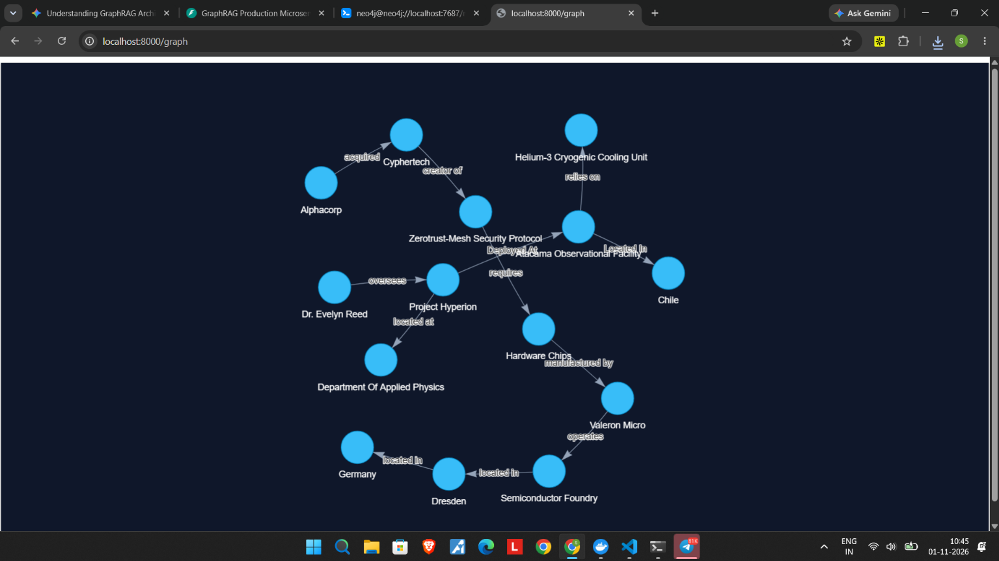
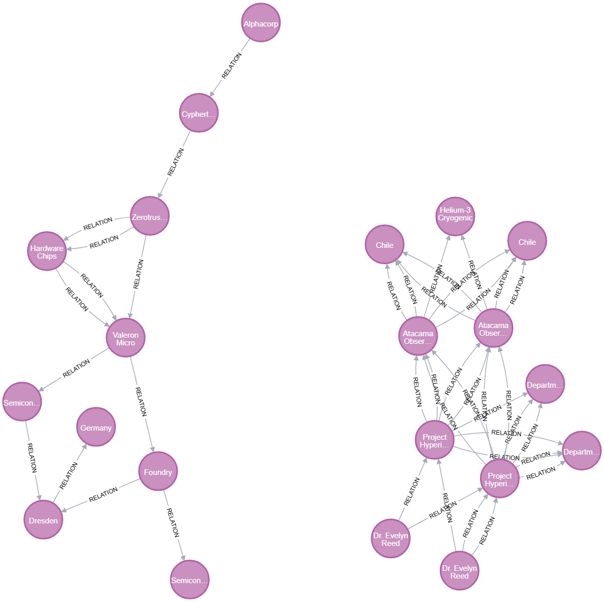

[](https://github.com/abhay28-03/GraphRAG/actions/workflows/ci.yml)

# GraphRAG: Enterprise Knowledge Graph & Multi-Hop Reasoning Microservice

## Interactive Graph Visualizations

| PyVis In-Memory Traversal | Neo4j Cypher Enterprise Graph |
| :---: | :---: |
|  |  |

A containerized GraphRAG engine combining **Neo4j**, in-memory **NetworkX** traversals, local ONNX embeddings (`bge-small-en-v1.5`), and **Groq LPUs** to resolve multi-hop reasoning failures inherent in standard dense vector retrieval.

---

## Architecture Overview

```
Unstructured Data ──► LLM Entity/Relation Extraction
                            │
                            ▼
               Semantic Entity Resolution (Cosine > 0.88)
                            │
               ┌────────────┴────────────┐
               ▼                         ▼
         NetworkX (RAM)            Neo4j (Cypher)
   (BFS & Louvain Clustering)   (ACID Persistent Store)
               │                         │
               └────────────┬────────────┘
                            │
     ┌──────────────────────┴──────────────────────┐
     ▼                                             ▼
Local Search (N-Hop BFS)              Global Search (Louvain)
(Granular Fact Chains)                (Dataset Sensemaking)
```

- **Semantic Entity Resolution:** Merges surface-form entity variants (cosine threshold > 0.88) before node insertion to eliminate graph fragmentation.
- **Dual-Retriever Modes:**
  - **Local Mode:** Performs bidirectional breadth-first search ($N$-hop) from seed entities to trace cross-document factual dependencies.
  - **Global Mode:** Leverages Louvain community detection to generate hierarchical cluster summaries for macro-level corpus questions.
- **Persistent Cypher Storage:** Replicates all extracted triples directly to Neo4j.
- **Zero Embedding API Cost:** Employs FastEmbed ONNX runtime (`BAAI/bge-small-en-v1.5`) executed locally.

---

## Evaluation Benchmark: Dense RAG vs. GraphRAG

| Query Type | Naive Vector RAG Context Recall | GraphRAG Engine Context Recall | Primary Failure Reason (Naive RAG) |
| :--- | :---: | :---: | :--- |
| **3-Hop Local Reasoning** | 0.0% | **100.0%** | Context fragmentation across disjoint passages |
| **Cross-Entity Dependency** | 0.0% | **100.0%** | Intermediate bridging entities lacked semantic similarity |
| **Global Sensemaking** | 33.3% | **100.0%** | Semantic search cannot synthesize non-local thematic clusters |

---

## Quickstart (Docker Compose)

### 1. Prerequisites
- Docker & Docker Compose
- Groq API Key

### 2. Configuration
Clone the repository and set your API key in a `.env` file:

```bash
git clone [https://github.com/](https://github.com/)<your-username>/GraphRAG.git
cd GraphRAG
cp .env.example .env
# Edit .env and supply GROQ_API_KEY
```

### 3. Spin Up Services

```bash
docker compose up --build -d
```

### 4. Interactive Endpoints
- **PyVis Force-Directed Visualizer:** `http://localhost:8000/graph`
- **FastAPI OpenAPI Documentation:** `http://localhost:8000/docs`
- **Neo4j Browser Console:** `http://localhost:7474` (User: `neo4j`, Password: `graphragpassword`)

---

## Local Development & Benchmark Execution

```bash
# Setup Virtual Environment
python -m venv .venv
source .venv/bin/activate  # On Windows: .\.venv\Scripts\Activate.ps1

# Install Dependencies
pip install -r requirements.txt

# Run Evaluation Benchmark
python run_benchmark.py
```
